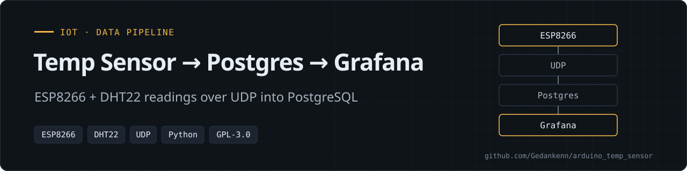
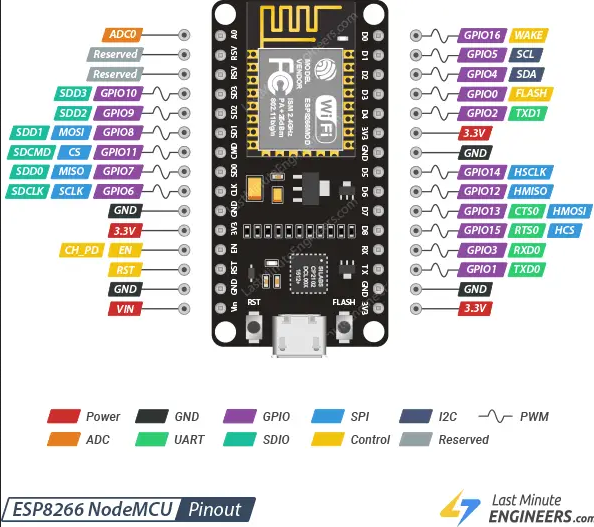
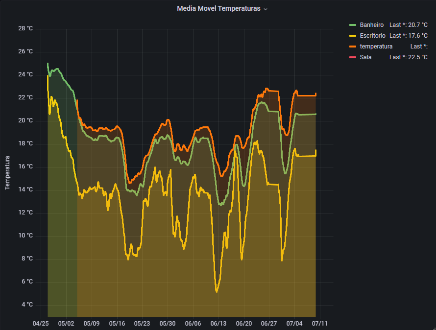

<p align="center"></p>

<p align="center">
  
  
  
  
  <a href="LICENSE"></a>
</p>

**Arduino Temp Sensor** reads temperature and humidity from a sensor and stores it in a PostgreSQL database; the data is then displayed in a Grafana dashboard.

> **Status: working course project.** Built for the Database 2 course: an ESP8266 reads a DHT22 sensor and sends the readings over UDP on the local network; a Python script receives them and inserts them into PostgreSQL, and Grafana plots the data.

## Overview

```text
ESP8266 + DHT22 ──UDP broadcast :1337──▶ Python receiver ──psycopg2──▶ PostgreSQL ──▶ Grafana
       ▲                                       │
       └──────── UDP broadcast :1338 ("testando", every 15 min) ──┘
```

1. `temp_sensor/postgresql_python_broadcast.py` broadcasts a trigger message to `192.168.100.255:1338` every 15 minutes and listens for readings on UDP port 1337.
2. The ESP8266 sketch (`temp_sensor/temp_sensor_db/temp_sensor_db.ino`) waits for a trigger on port 1338, averages 5 temperature/humidity readings from the DHT22, and broadcasts a CSV line (`01,esp_1,Interno,<temperature>,<humidity>`) to `192.168.100.255:1337`.
3. The Python receiver splits the message and inserts it into the `SensorData` table of the `APS_BANCO` database.

The receiver reads the last four fields (`esp`, `location`, `temperature`, `humidity`) into `SensorData`; the leading `01` is ignored.

## Features

- Polling over the LAN: the receiver broadcasts a trigger every 15 minutes; the sensor answers with an averaged reading (5 samples)
- Readings stored in PostgreSQL (`SensorData` table), plotted in Grafana
- Credentials kept out of git (`secrets.h`, `.env`)

## Hardware

### ESP8266 pinout

| DHT22 | ESP8266 |
|---|---|
| VCC | 3.3 V |
| GND | GND |
| DATA | GPIO5 |



## Architecture


| File | Purpose |
|------|---------|
| `temp_sensor/temp_sensor_db/temp_sensor_db.ino` | ESP8266 Arduino sketch (DHT22 on GPIO5, Wi-Fi STA, UDP) |
| `temp_sensor/postgresql_python_broadcast.py` | UDP trigger sender + receiver that writes to PostgreSQL |
| `temp_sensor/postgresql_python.py` | Earlier TCP version of the receiver (listens on TCP port 1337) |
| `temp_sensor/python_socket_test.py` | UDP test: sends the trigger every 10 s and prints what it receives |
| `esp8266.png`, `grafana.png` | Pinout and dashboard screenshots |

## Build & Flash

### Requirements
- ESP8266 board (Arduino core for ESP8266)
- DHT22 sensor
- Arduino libraries: "DHT sensor library" and "Adafruit Unified Sensor"
- Python 3 with `psycopg2` and `python-dotenv`
- PostgreSQL
- Grafana

### Setup

1. Install the Arduino libraries:
```bash
$ arduino-cli lib install "DHT sensor library"
$ arduino-cli lib install "Adafruit Unified Sensor"
```

2. Create the database and table used by the Python scripts (the column names come from the scripts' `INSERT`; the column types below are a suggestion):
```text
$ psql
CREATE DATABASE "APS_BANCO";
\c "APS_BANCO"
CREATE TABLE SensorData (esp TEXT, localizacao TEXT, temperatura TEXT, humidade TEXT, tempo TIMESTAMP);
```

3. Credentials are kept out of git:
   - Wi-Fi: `cp temp_sensor/temp_sensor_db/secrets.h.example temp_sensor/temp_sensor_db/secrets.h` and set `SSID` / `PASSWD`.
   - PostgreSQL: `cp temp_sensor/.env.example temp_sensor/.env` and set `PG_USER`, `PG_PASSWORD`, `PG_HOST` (optional `PG_PORT`, `PG_DATABASE`).
   
   Both files are gitignored. The broadcast address `192.168.100.255` is hard-coded in both the sketch and the receiver, so change it to match your network.

4. Upload the sketch to the ESP8266 and run the receiver:
```bash
$ pip install psycopg2-binary python-dotenv
$ python3 temp_sensor/postgresql_python_broadcast.py
```

5. Create a PostgreSQL datasource in Grafana pointing to `APS_BANCO`, and a time-series panel with a query such as:
```text
SELECT
  $__time(tempo),
  temperatura::float
FROM SensorData
```

## Results

Grafana dashboard with the recorded data:



## License

GNU GPL v3, see [LICENSE](LICENSE).

---
<sub>Part of <a href="https://github.com/Gedankenn">Fabio Slika Stella's</a> embedded work · <a href="https://gedankenn.github.io/Gedankenn/">portfolio</a></sub>
